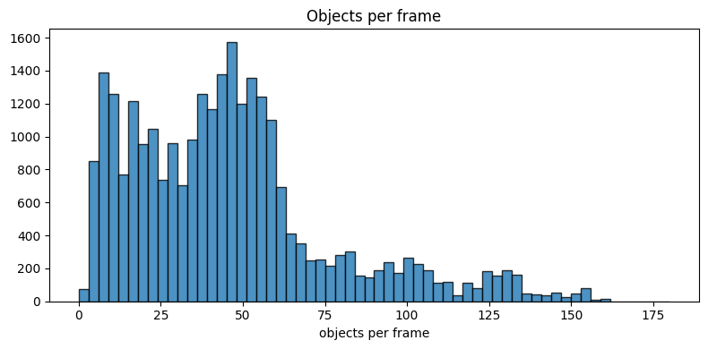

## Introduction

We study object detection in drone video frames from the UCU AI 2026 competition. The dataset contains eight target classes and many small, partially occluded objects. Our goal is to compare detector families under a common validation protocol and develop an inference pipeline that improves detection of small objects without changing the evaluation data.

## Data Understanding and Preprocessing

We retained the supplied split by video sequence to avoid leakage from near-duplicate frames. It contains 56 train clips and 7 validation clips with no shared clip names; one high-resolution clip contributes 34% of validation frames.

| Split | Clips | Frames | Objects | Ignored regions |
|---|---:|---:|---:|---:|
| Train | 56 | 24,201 | 1,105,516 | 63,843 |
| Validation | 7 | 2,846 | 114,132 | 3,995 |

COCO annotations with `iscrowd = 0` were used as targets; `iscrowd = 1` boxes were ignored. A check on 400 sampled frames matched YOLO and COCO boxes by class and geometry. Object size was measured as $\sqrt{wh}$: the median was 46.4 pixels and 24% of objects were COCO-small. Person and car dominated the data, while bus represented less than 1%.

Scene density varied from 5 to 143 objects per frame, with a maximum close to 180, so evaluation used `maxDets = 300`. Ignored regions occurred in 72% of frames but covered only 2.3% of image area on average. They were mean-colour masked during training and preserved for COCO evaluation. Since 47% of objects were partly occluded, Soft-NMS was also tested.

At a 640-pixel long side, more than half of objects were below 16 pixels. We therefore used 1280, mild scale/colour/blur augmentation, and no validation augmentation. K-means box sizes at input 1024 spanned roughly 7--100 pixels, motivating smaller anchors, a stride-4 head and tiled inference. Main experiments used every fifth frame; temporal experiments used all validation frames.
