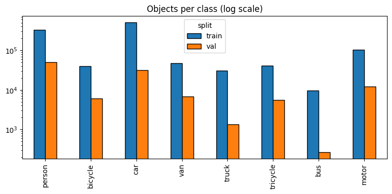
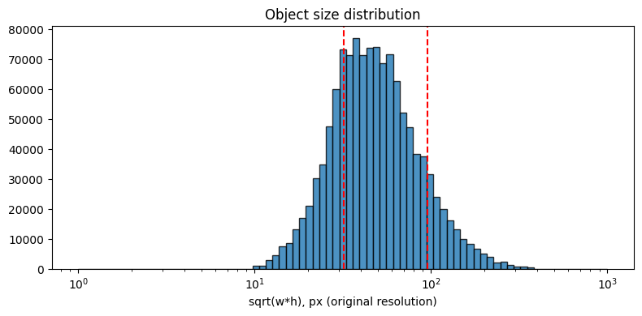

## Introduction

We work with drone video frames from the UCU AI 2026 competition. The dataset has eight object classes, many small objects, and frequent occlusion. We compare several detector families using the same validation setup and then build a final pipeline for better small-object detection.

## Data Understanding and Preprocessing

We kept the original split by video sequence. This avoids leakage from almost identical frames in the same clip. There are 56 training clips and 7 validation clips. One high-resolution clip contains 34% of all validation frames.

| Split | Clips | Frames | Objects | Ignored regions |
|---|---:|---:|---:|---:|
| Train | 56 | 24,201 | 1,105,516 | 63,843 |
| Validation | 7 | 2,846 | 114,132 | 3,995 |

COCO boxes with `iscrowd = 0` were used as targets. Boxes with `iscrowd = 1` were ignored. We checked 400 random frames and found that the YOLO and COCO boxes matched in class and position. We measured object size as $\sqrt{wh}$. The median size was 46.4 pixels, and 24% of objects were COCO-small. Person and car were the most common classes, while bus made up less than 1% of the data.

The number of objects varied from 5 to 143 per frame, with a maximum close to 180. So we used `maxDets = 300` during evaluation. Ignored regions appeared in 72% of frames but covered only 2.3% of the image area on average. During training, we filled them with the mean colour. During evaluation, we kept them as ignored regions. Since 47% of objects were partly occluded, we also tested Soft-NMS.

With a 640-pixel long side, more than half of the objects became smaller than 16 pixels what makes them hard to detect. We therefore used 1280 pixels, mild scale (augmentation by changing scale a bit), colour and blur augmentation, and no augmentation for validation. K-means gave box sizes of about 7--100 pixels at input 1024. This led us to test smaller anchors, a stride-4 head and tiled inference. For the main experiments, we used every fifth frame.

## Faster R-CNN

**Protocol.** We used Faster R-CNN with a COCO-pretrained ResNet-50 FPN. We trained it for six epochs with batch size 4 (these numbers where mainly selected with a purpose to optimize learning time to be able to use google colab gpu session), SGD and a onecycle learning-rate schedule. The input long side was 1280 pixels. We used smaller anchors from the dataset and allowed up to 300 boxes per image.

**Result.**

| mAP | AP50 | AP_small | FPS |
|---:|---:|---:|---:|
| 0.2023 | 0.4271 | 0.1019 | 5.74 |

Increasing the number of RPN proposals from 500 to 2,000 changed mAP only from 0.2000 to 0.2026 and made inference slower. GIoU box loss also performed worse than the standard loss (0.2009 versus 0.2023 mAP), so we kept the baseline.

The RPN first finds possible object regions. The RoI head then classifies these regions and improves their boxes. This helps remove some background in crowded frames. However, adding more proposals gave only a small gain, so the main problems were still small-object features and box localization.

**Errors.** The model often missed tiny objects. In dense scenes, boxes were not always precise, and similar classes were sometimes confused. These results motivated the later high-resolution and tiled inference experiments.

## RetinaNet

**Protocol.** RetinaNet used the same pretrained backbone, data split, six-epoch budget and COCO evaluation as Faster R-CNN. This gave us a comparison between the two anchor-based models.

**Result.**

| mAP | AP50 | AP_small | FPS |
|---:|---:|---:|---:|
| 0.1360 | 0.2681 | 0.0508 | 5.36 |

Smaller anchors from the dataset reduced mAP to 0.0975. The focal-loss variant reached 0.1037.

Unlike Faster R-CNN, RetinaNet predicts classes and box offsets at many feature-map locations without a proposal stage. This produces many easy background examples, especially in crowded scenes. Focal loss was meant to reduce this problem, but it still performed worse than the default setup.

**Conclusion.** The smaller anchors and focal loss did not solve the assignment problem. The low AP_small score and errors in crowded scenes suggest that removing the proposal stage is difficult for this dataset.

## YOLOv8: One-stage Anchor-free Detector

**Protocol.** We trained YOLOv8m for six epochs using the same 1280-pixel inputs, sampled frames, batch size and COCO evaluation. YOLOv8 is anchor-free: each feature-map location predicts class scores and distances to the four box sides. NMS is then used to remove duplicate boxes. We tested an extra stride-4 P2 head and a box loss that mixes CIoU with Normalized Wasserstein Distance (NWD).

**Results.**

| Variant | mAP | AP50 | AP_small | FPS |
|---|---:|---:|---:|---:|
| YOLOv8 baseline | 0.1996 | 0.3795 | 0.1148 | 19.69 |
| YOLOv8 + P2 head | 0.1966 | 0.3872 | 0.1413 | 14.73 |
| YOLOv8 + NWD | 0.1813 | 0.3590 | 0.1333 | 10.50 |

The P2 head slightly reduced overall mAP but improved AP_small from 0.1148 to 0.1413. This shows that the extra high-resolution head helped with tiny objects, but made the model slower. NWD also improved AP_small compared with the baseline, but reduced overall mAP. YOLOv8 was the fastest detector, while RT-DETR was more accurate with the same short training budget.

## RT-DETR: Query-based Detector

**Protocol.** RT-DETR-L was trained for six epochs with AdamW, the same sampled frames and input size, and the same COCO evaluation. Instead of making predictions at every location, it uses a fixed set of object queries. During training, Hungarian matching pairs queries with ground-truth objects. Because of this, the model does not need the usual class-wise NMS step during inference.

**Results.**

| Variant | mAP | AP50 | AP_small | FPS |
|---|---:|---:|---:|---:|
| RT-DETR baseline | 0.2422 | 0.4579 | 0.1214 | 7.31 |
| RT-DETR, 500 queries | **0.2508** | **0.4801** | **0.1393** | 4.97 |
| RT-DETR, higher box costs | 0.2136 | 0.4337 | 0.1266 | 4.97 |

Increasing the number of queries from 300 to 500 improved all accuracy metrics, especially AP50, but made the model slower. Increasing the box and GIoU weights in the matching cost gave a worse result within six epochs. RT-DETR had the best single-model mAP and worked well in crowded scenes, but its lower FPS encouraged us to use it carefully in the final pipeline.

## Final Pipeline

We started the final pipeline with `rtdetr_q500`, our best single model. We tested all variants on the same 571 validation frames with the same COCO evaluator. This made it easier to see which change actually helped.

**Inference-time experiments.** We processed each frame as a full image, as a horizontally flipped image, and as four overlapping tiles. Each tile covered 60% of the image width and height, so small objects appeared about 1.7 times larger. We moved tile predictions back to the original image and combined them with NMS, Soft-NMS or Weighted Box Fusion (WBF).

| Pipeline | mAP | AP50 | AP_small |
|---|---:|---:|---:|
| RT-DETR full frame | 0.2506 | 0.4794 | 0.1372 |
| Full + tiles, WBF max score | 0.2584 | 0.4970 | 0.1474 |
| Full + flip + tiles, WBF max score | **0.2651** | **0.5069** | **0.1526** |

We selected the full + flip + tiles configuration with WBF max score. Soft-NMS helped in some crowded scenes, but WBF worked better when combining predictions from different scales. The final setup needs six forward passes and runs at 1.46 FPS. Therefore, it is aimed at leaderboard accuracy rather than real-time use.

**Ensemble and tile fine-tuning.** We added another model only when it improved validation mAP by at least 0.001. The selected ensemble was `rtdetr_q500 + yolo_base + rtdetr_base`. It reached mAP 0.2915 and AP_small 0.2070. We then fine-tuned `rtdetr_q500` for two more epochs on randomly selected training tiles with a lower learning rate of $5\times10^{-5}$. Using this model only for the tile predictions raised the ensemble to mAP **0.2930** and AP_small **0.2075**. This was our final submission pipeline.

## Summary of All Models
ensemble_ft
All rows use the same 571 validation frames (every 5th frame in 7 clips 2826/571~=571) and COCO evaluation. Anchor-based models were scored by AP_medium and AP_large (objects of size >= 32*32px).

| Model | mAP | AP_small | AP_medium | AP_large | Public LB | Private LB |
|---|---:|---:|---:|---:|---:|---:|
| Faster R-CNN | 0.2022 | 0.1024 | 0.1825 | 0.3778 | 0.2153 | 0.1802 |
| Faster R-CNN, GIoU loss | 0.2013 | 0.1021 | 0.1823 | 0.3747 | - | - |
| RetinaNet, default anchors | 0.1360 | 0.0509 | 0.1165 | 0.2812 | - | - |
| RetinaNet, small anchors | 0.0973 | 0.0481 | 0.0875 | 0.1991 | - | - |
| RetinaNet, small anchors, $\gamma = 1.5$ | 0.1037 | 0.0475 | 0.0958 | 0.2071 | - | - |
| YOLOv8m | 0.1996 | 0.1148 | 0.1840 | 0.3303 | 0.2414 | 0.1946 |
| YOLOv8m + P2 head | 0.1966 | 0.1413 | 0.1834 | 0.3433 | - | - |
| YOLOv8m + NWD loss | 0.1813 | 0.1333 | 0.1778 | 0.2934 | - | - |
| RT-DETR-L | 0.2422 | 0.1214 | 0.2111 | 0.4167 | - | - |
| RT-DETR-L, 500 queries | 0.2508 | 0.1393 | 0.2332 | 0.4028 | 0.2950 | 0.2215 |
| RT-DETR-L, higher box costs | 0.2136 | 0.1266 | 0.2072 | 0.3606 | - | - |
| RT-DETR-L 500q, full + flip + tiles | 0.2651 | 0.1526 | 0.2600 | 0.4151 | - | - |
| Same, tiles from fine-tuned copy | 0.2716 | 0.1416 | 0.2537 | 0.4375 | - | - |
| Ensemble of 3 models | 0.2915 | 0.2070 | 0.2658 | 0.4713 | 0.3000 | 0.2448 |
| Ensemble, fine-tuned tiles | 0.2930 | 0.2075 | 0.2641 | 0.4776 | 0.3009 | 0.2514 |
| Ensemble, fine-tuned tiles + temporal rescoring | 0.2971 | 0.1918 | 0.2634 | 0.4938 | 0.3063 | 0.2435 |

Every pipeline step raised validation mAP, and the ensemble gave the largest gain (+0.026). We chose the final submissions by validation mAP, before private scores were shown: ensemble_ft_temporal(0.3063). But when private scores were shown our best model is ensemble_ft (0.2514). Very strange gap to be honest: in private LB all scores dropped significantly, by 0.05 usually, what is 25-30% drop of our results in public LB.

## Bonus tasks

### Data Temporality

A real object stays in place for several frames, while a false detection often appears only once as we have sequence of photos takes in a raw. Si this can taken to remove noisy objects and improve confidence in the correct objects.

In each of the $K$ frames (from 1 to 3) before and after a box, we took the best score of a same-class box with IoU above a threshold (0 if none). Their mean is the support, and the new score is $s' = (1 - \alpha)\,s + \alpha \cdot \text{support}$ ($\alpha$ we tried 0.25 and 0.5). We predicted all 2,846 validation frames and scored the same 571.

| Pipeline | Setting | mAP | AP_small | Gain |
|---|---|---:|---:|---:|
| RT-DETR-L, 500 queries | none | 0.2506 | 0.1372 | |
| | $K = 3$, $\alpha = 0.25$, IoU 0.3 | 0.2540 | 0.1392 | +0.0034 |
| | same, previous frames only | 0.2539 | 0.1385 | +0.0033 |
| Ensemble, fine-tuned tiles | none | 0.2930 | 0.2075 | |
| | $K = 3$, $\alpha = 0.5$, IoU 0.3 | **0.2971** | 0.1918 | **+0.0041** |
| | same, previous frames only | 0.2952 | 0.1908 | +0.0021 |

For the ensemble, AP_small fell. Small boxes probably shift more between frames compared with their size, so they fail the IoU match. Rescoring gave the best public score (0.3063) but a lower private score than without it (0.2435 versus 0.2514), so a gain of 0.004 is likely a noise.

## Final Model and Run Instructions

**Final model.** RT-DETR-L with 500 queries, YOLOv8m and RT-DETR-L. The 500-query model takes its tile predictions from the copy fine-tuned on tiles. The three models are merged with WBF at IoU 0.55.

**Environment.** Colab and Kaggle GPUs sessions, Python 3.13 and preinstalled PyTorch 2.11-2.14, plus `ultralytics==8.4.208`, `ensemble-boxes==1.0.9`, `pycocotools` and scikit-learn. Seed - 42.

**How to run.** Open `notebooks/UCU_AI_hw2_Zabchuk_Fito.ipynb` and run everything there in session with gpu.
